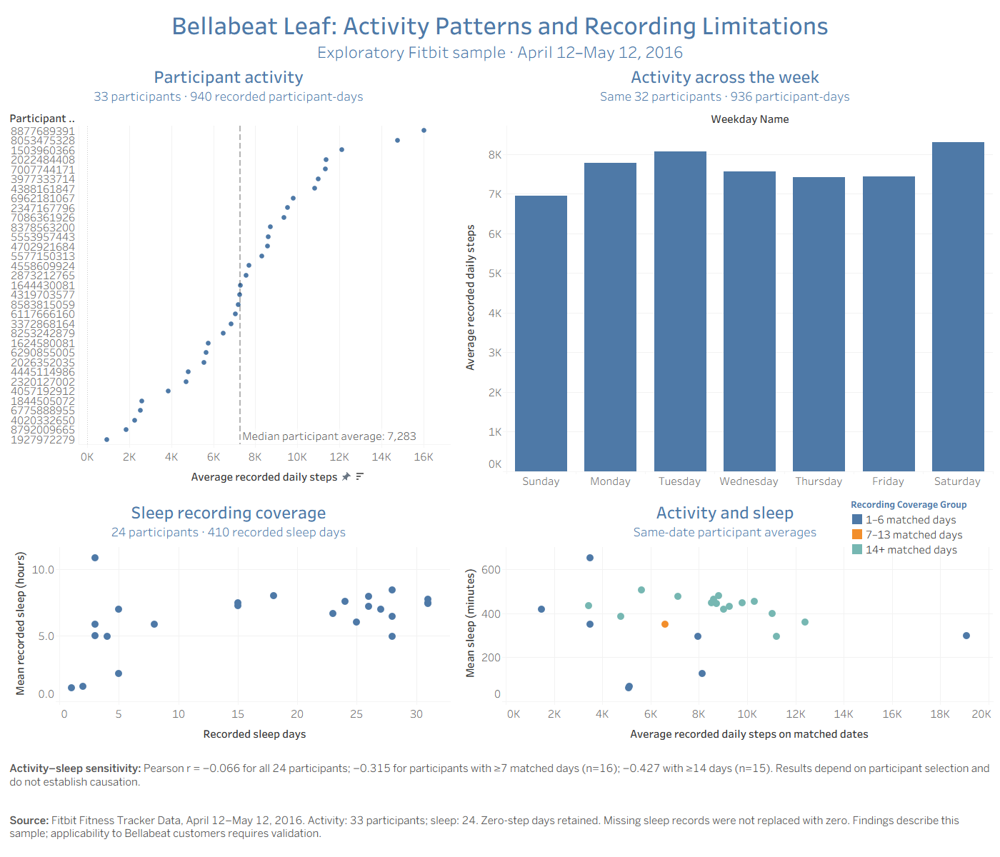

# Bellabeat Leaf: Activity Patterns and Recording Limitations

A Google Data Analytics case study using **Google BigQuery SQL and Tableau** to
explore Fitbit activity and sleep records and develop testable marketing
hypotheses for Bellabeat Leaf.

## Project at a glance

| Item | Scope |
|---|---|
| Business question | How could observed smart-device patterns inform Leaf marketing hypotheses? |
| Selected period | April 12-May 12, 2016 |
| Activity | 940 recorded participant-days from 33 source IDs |
| Sleep | 410 deduplicated participant-days from 24 source IDs |
| Weekday comparison | Same 32 participants across seven weekday categories; 936 days |
| Tools | GoogleSQL in BigQuery; Tableau Desktop/Public; CSV; Markdown |

This is an educational case study, not work commissioned by Bellabeat. Product
context comes from the historical brief. Fitbit participants are not verified
Bellabeat customers; marketing actions below are proposals, not measured outcomes.

## Main findings

- The median participant mean recorded daily steps was **7283**, with the middle
  half of participant means spanning **5567-9520** steps.
- In the same-participant weekday comparison, Saturday averaged **8303** steps
  and Sunday **6950**. This does not establish optimal marketing days.
- Sleep summaries depended on recording coverage: the participant-equal mean
  was **377.45 minutes** for all 24 participants, **424.50** with at least seven
  recorded days (16 participants), and **429.50** with at least 14 (15 participants).

Activity-sleep correlation is supporting exploration. Across participant means,
r changed from -0.066 to -0.315 and -0.427 under those coverage restrictions;
neither restricted estimate establishes a within-person or causal relationship.

## View the work

- [Case-study report](reports/final_case_study.md)
- [Executive summary](reports/executive_summary.md)
- [Packaged Tableau workbook](visualizations/Bellabeat_Analysis.twbx) — includes
  source summaries; learner-tested reopening and click highlighting.
- [Full dashboard image](visualizations/bellabeat_dashboard.png)
- [Diagnostic correlation plot](visualizations/activity_sleep_diagnostic.png)
- [SQL scripts](sql/)
- [Data dictionary](documentation/data_dictionary.md)
- [Cleaning log](documentation/cleaning_log.md)
- [Data sources and ROCCC](documentation/data_sources_and_roccc.md)

No public Tableau URL is claimed yet. Add it after publishing and viewer testing.

## Analytical decisions

Preserved raw files and imported raw columns as text. Parsed dates explicitly,
trimmed IDs, cast selected numeric measurements and validated daily keys. Removed
only three exact extra sleep copies using all five source fields. Retained
zero-step days and flagged unusual recording patterns without declaring nonwear.

Validated the ID/date join: 940 activity rows were preserved, with 410 matched
sleep records and 530 unmatched activity days. Missing sleep was not imputed as
zero. Distinguished daily-row averages from equally weighted participant means,
and tested coverage and individual-observation sensitivity before interpretation.

## Proposed business actions

1. Test weekly movement messaging against general wellness messaging.
2. Research self-reported goals and test preference-based messages within groups.
3. Investigate Bellabeat-specific recording barriers and, if supported, test
   sleep-feature education.

No campaign was run and no conversion, revenue or health improvement is claimed.
See [recommendation evidence and test plans](reports/marketing_recommendations_draft.md).

## Reproduce the analysis

1. Obtain the [specified Kaggle dataset](https://www.kaggle.com/datasets/arashnic/fitbit).
   Select the April 12-May 12 export. Keep original CSVs unchanged. The original
   research deposit is [Furberg et al. (2016), Zenodo](https://doi.org/10.5281/zenodo.53894).
2. In BigQuery, create `bellabeat_raw` and `bellabeat_clean` in the same location.
   Import `dailyActivity_merged.csv` as `daily_activity` and `sleepDay_merged.csv`
   as `daily_sleep`, preserving source column names; use STRING for all raw fields,
   skip one header row, and allow zero malformed rows.
3. Replace `bellabeat-portfolio-513605` with your project ID in the SQL scripts.
   Run `01` and `03` once to create clean tables; `CREATE TABLE` intentionally
   reports Already Exists on a repeated creation. Run read-only checks `02`, `04`,
   `05` and `06`, then descriptive analyses `07`-`10`.
4. Run statements in [11_tableau_summary_exports.sql](sql/11_tableau_summary_exports.sql)
   independently. Export to its exact indicated CSV filenames; the weekday export
   comes from the second statement of `10_weekday_activity.sql`.
5. Open the packaged `.twbx` in Tableau to view the included summary data. For
   refreshed analysis, reconnect to the newly exported CSVs or build from those
   sources. The older loose `.twb` is superseded and retains earlier interaction
   settings. Keep IDs as text dimensions. Tableau charts use separate summaries
   with different grains; no join between summary files is required.
6. Optional independent local QA: with Python 3.10+, run
   `python scripts/verify_portfolio.py` from this checkout. It uses only the
   standard library and writes `reports/qa_results.json`. It checks raw data,
   summary exports, interpolation quartiles, correlations, local Markdown links
   and workbook configuration; it does not execute BigQuery or test Tableau UI.

Keep these files in the project root for the existing workbook and QA script:

- `dailyActivity_merged.csv`
- `sleepDay_merged.csv`
- `participant_steps_summary.csv`
- `weekday_steps_same_participants.csv`
- `Sleep Analysis Participant-Level Summary.csv`
- `Activity Sleep Analysis Participant Level Matched Days.csv`

Confirm source licensing before redistributing files publicly. The brief describes
CC0 licensing; current dataset-specific metadata was not independently retrieved.
Raw data need not be uploaded for readers to follow the source acquisition steps.

## Quality assurance and limitations

Independent local recalculation reproduced the reported numerical results. Full
interpolated quartiles were preserved; rounded display values are not approximate
quantile estimates. The source describes thirty users while the selected activity
file contains 33 distinct IDs; this discrepancy remains explicit and unresolved.

The small historical sample, uneven coverage and absent customer/campaign context
limit applicability. No causal or current-market inference is claimed.

The learner validated click-based coverage highlighting and reset without dimming
the other charts, and reopened a copied `.twbx` successfully. Package inspection
confirms one scoped Select action and embedded CSVs. The complete 1400x1200 native
PNG export was visually reviewed. Hover is not the intended interaction.
See [publication QA](documentation/publication_qa.md) for remaining provenance
limits and post-publication viewer/link checks.

## Skills demonstrated

SQL cleaning and type validation; composite-key and join checks; CTEs, GROUP BY,
HAVING, CASE, aggregate/window functions; descriptive statistics; sensitivity
analysis; Tableau chart construction and highlighting; source assessment; and
evidence-to-recommendation communication.

The learner executed BigQuery queries and built the Tableau workbook with guided
mentoring. Local QA scripts and documentation were developed with technical
assistance. [Interview notes](documentation/interview_guide.md) explain the
reasoning and boundaries of the work.
